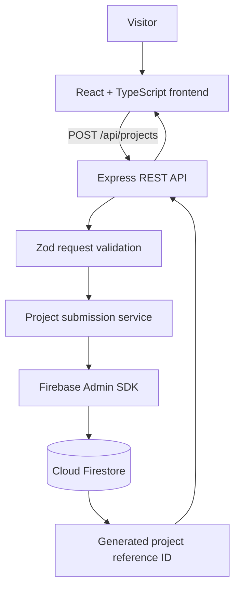

# Cynbit Blueprint

**Interactive Project Discovery & Scope Builder**

Cynbit Blueprint is a full-stack assessment prototype that helps prospective customers turn an initial business idea into a structured project enquiry. Instead of relying only on a generic contact message, it guides visitors through service selection, relevant project questions, technical requirements and a reviewable project brief.

> This is an independently developed assessment prototype. It is not connected to Cynbit's production systems and does not represent an official Cynbit product or service commitment.

## Live Demo

- **Frontend:** https://cynbitblueprint-assessment.vercel.app/
- **Backend health check:** https://cynbit-blueprint-assessment.onrender.com/api/health
- **Source code:** https://github.com/HA24RSH/cynbit-blueprint-assessment

The backend may take a short time to wake up when hosted on a free Render instance after a period of inactivity.

## Problem Identified

A prospective customer may know the business problem they want to solve without knowing which service, technical approach or information a development team needs to scope the work. A generic enquiry form can capture a message, but it does not necessarily guide the visitor through service-specific requirements or produce a consistent brief for an initial discussion.

## Proposed Improvement

Cynbit Blueprint introduces a guided, four-step project discovery experience:

1. **Service discovery** — the visitor selects Software Development, AI & Automation, Cloud & DevOps, Digital Marketing, or Not Sure Yet.
2. **Project requirements** — the form asks questions based on the selected service, alongside the project stage and business problem.
3. **Technical details** — the visitor can specify preferred technologies, integrations, expected scale, security needs, timeline and budget.
4. **Project blueprint** — the application compiles the answers into a structured summary that can be reviewed, copied or downloaded before the visitor submits an enquiry.

The goal is to make project enquiries more structured and help both the visitor and the team begin a discussion with clearer context.

## Implemented Features

- Four-step guided project discovery flow.
- Five service categories.
- Conditional questions for each service category.
- Single-select and multi-select controls.
- Required-field validation for project stage and problem description.
- Optional technical preferences and project constraints.
- Review screen that compiles the collected answers into a project brief.
- Deterministic, service-specific initial technical considerations. These are suggestions for discussion, not an automatically generated or validated architecture.
- Copy-to-clipboard and downloadable plain-text project brief.
- Contact name and email capture at submission.
- Express REST API with server-side request validation using Zod.
- Firestore persistence through the Firebase Admin SDK.
- Server-generated project reference ID after a successful database write.
- Basic request rate limiting and CORS configuration.

## Technology Stack

| Layer | Technology |
|---|---|
| Frontend | React, TypeScript, Vite |
| UI icons | Lucide React |
| Backend | Node.js, Express |
| Validation | Zod |
| Database | Firebase Cloud Firestore |
| Database access | Firebase Admin SDK |
| API protection | express-rate-limit |
| Frontend hosting | Vercel |
| Backend hosting | Render |

## Architecture



The frontend sends the project category, collected answers and contact details to the backend. The API validates the request before saving it to the `project_inquiries` Firestore collection. The backend returns a reference ID only after the database write succeeds.

## API Endpoints

| Method | Endpoint | Description |
|---|---|---|
| `GET` | `/api/health` | Returns API health information. |
| `POST` | `/api/projects` | Validates and stores a project enquiry. |

### Successful submission

A successful project submission returns HTTP `201 Created` with a response similar to:

```json
{
  "success": true,
  "message": "Project enquiry submitted successfully.",
  "data": {
    "referenceId": "CYN-2026-XXXXXXXX"
  }
}
```

The reference ID above is an example format; each actual ID is generated from the Firestore document ID.

## Run Locally

### Prerequisites

- Node.js (the project was developed with Node.js 24.x)
- npm
- A Firebase project with Cloud Firestore enabled
- A Firebase service-account key for local backend development

### 1. Clone the repository

```bash
git clone https://github.com/HA24RSH/cynbit-blueprint-assessment.git
cd cynbit-blueprint-assessment
```

### 2. Configure the backend

```bash
cd server
npm install
```

Create `server/.env`:

```env
PORT=5000
CLIENT_ORIGIN=http://localhost:5173
GOOGLE_APPLICATION_CREDENTIALS=./serviceAccountKey.json
```

Place your Firebase service-account JSON file at `server/serviceAccountKey.json`. The file is required for local development but is ignored by Git and must never be committed.

Start the backend:

```bash
npm run dev
```

The API runs at `http://localhost:5000` by default. Check `http://localhost:5000/api/health` to verify it is running.

### 3. Configure the frontend

Open a second terminal from the repository root:

```bash
cd client
npm install
```

Create `client/.env`:

```env
VITE_API_URL=http://localhost:5000
```

Start the frontend:

```bash
npm run dev
```

Open the Vite URL shown in the terminal (normally `http://localhost:5173`).

### 4. Build the frontend

From the `client` directory:

```bash
npm run build
```

## Environment Variables

### Backend (`server/.env`)

| Variable | Purpose | Example |
|---|---|---|
| `PORT` | Port used by Express locally; the hosting platform can supply its own port. | `5000` |
| `CLIENT_ORIGIN` | Comma-separated list of allowed frontend origins. | `http://localhost:5173` |
| `GOOGLE_APPLICATION_CREDENTIALS` | Path to the Firebase service-account JSON file. | `./serviceAccountKey.json` |

### Frontend (`client/.env`)

| Variable | Purpose | Example |
|---|---|---|
| `VITE_API_URL` | Base URL of the Express API. | `http://localhost:5000` |

**Never put Firebase service-account credentials or other private secrets in frontend environment variables.** Variables prefixed with `VITE_` are included in the browser bundle. In deployment, configure the Firebase credential using the hosting provider's protected secret-file or secret-management feature.

## Deployment

- **Frontend:** Vercel, with `client` as the Root Directory, build command `npm run build`, output directory `dist`, and `VITE_API_URL` set to the deployed backend URL.
- **Backend:** Render, with `server` as the Root Directory, build command `npm ci`, start command `npm start`, and `CLIENT_ORIGIN` set to the deployed Vercel origin.
- **Firebase:** Cloud Firestore stores submitted enquiries. The backend uses the Firebase Admin SDK and a protected service-account credential.

The exact production environment values are managed in the Vercel and Render dashboards and are intentionally not committed to this repository.

## Current Limitations

- The downloadable brief is currently plain text, not a designed PDF.
- The prototype does not include a customer account, saved drafts or an enquiry-status dashboard.
- The prototype does not include an internal admin dashboard for reviewing enquiries.
- The technical considerations are deterministic suggestions based on the selected service; they are not an AI-generated solution, verified architecture, effort estimate or quotation.
- The in-memory rate limiter is suitable for a small single-instance prototype; a production multi-instance deployment would need a shared rate-limit store.
- The application has basic server-side validation and CORS controls, but it has not undergone a formal security audit or penetration test.

## Assessment Deliverables

- **Live prototype:** https://cynbitblueprint-assessment.vercel.app/
- **Source repository:** https://github.com/HA24RSH/cynbit-blueprint-assessment
- **Backend health endpoint:** https://cynbit-blueprint-assessment.onrender.com/api/health
- **Technical report:** to be added under `docs/technical-report.pdf` when finalised.

## Author

**Harshvardhan Gadagade**

GitHub: [@HA24RSH](https://github.com/HA24RSH)

---

*Built as a Full Stack Developer Intern technical assessment prototype.*
